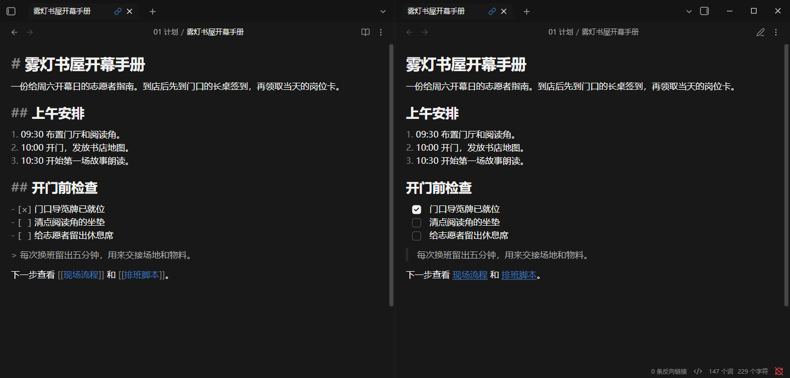
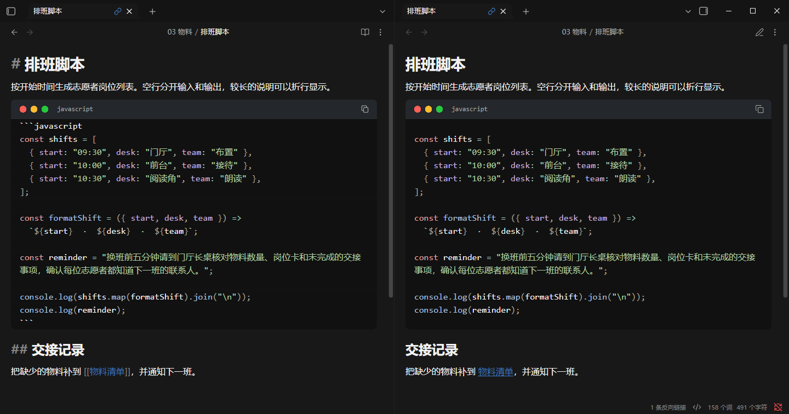
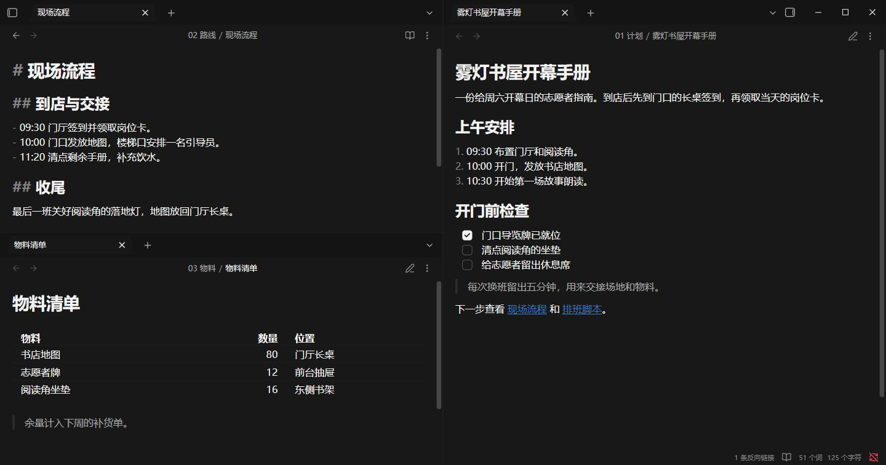
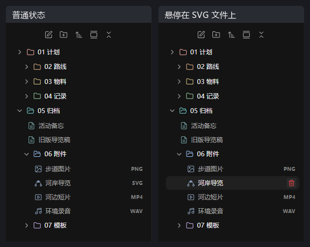
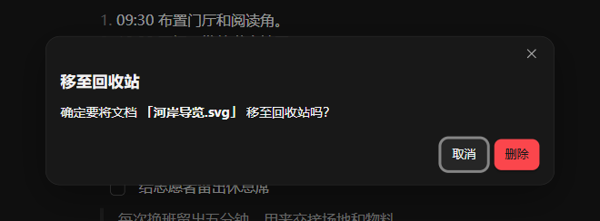
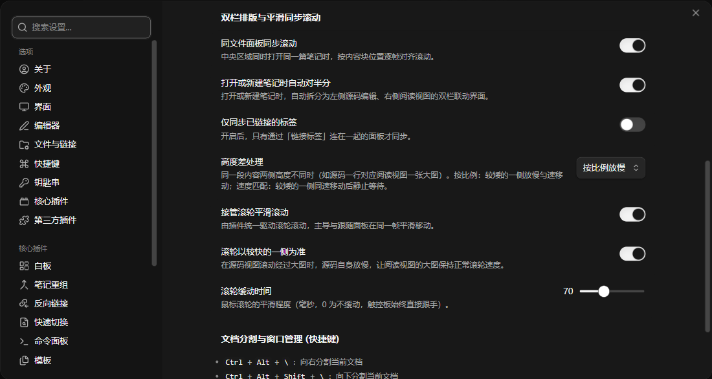

# Better Obsidian

Obsidian 桌面端增强插件，整合平滑同步滚动、自动双栏、文档分割管理、文件列表回收站与快捷重命名。当前版本 **1.1.0**，最低需要 Obsidian **1.7.0**。

配套主题：[Codex UI For Obsidian](https://github.com/Plantforlife/Codex-UI-For-Obsidian)。插件可以独立使用，也为 Codex UI For Obsidian 的悬浮功能区提供文件列表可见性识别与文件夹选择反馈。

## 截图与示例

截图使用 Obsidian 1.15.1、Better Obsidian 当前 `main` 和配套的 Codex UI For Obsidian 主题。文件和内容均来自为文档创建的虚构演示库。可以把示例 Markdown 文件复制到自己的库中体验。 [雾灯书屋示例笔记](docs/examples/)

### 自动双栏

打开《雾灯书屋开幕手册》后，左侧可编辑 Markdown 源码，右侧可阅读排版后的清单和引用。在任意一侧打开或新建另一篇笔记时，自动双栏沿用同一布局。使用「对半分：源码 / 阅读」命令可关闭当前笔记的阅读视图。 [开幕手册](docs/examples/雾灯书屋开幕手册.md)



### 代码块与同步滚动

《排班脚本》在两侧显示相同的 JavaScript 高亮、语言标签和复制按钮。脚本包含段落间的空行与会折行的长字符串，可用来观察两侧高度不同时的同步效果。打开「同文件面板同步滚动」后，滚动任一侧，另一侧会按内容位置跟随。 [排班脚本](docs/examples/排班脚本.md)



### 手动安排窗格

用「向右分割当前文档」和「向下分割当前文档」留出独立的工作区。图中左侧上方显示《现场流程》，左侧下方显示《物料清单》，右侧保留完整的开幕手册。自动双栏会保留这些手动分割。 [现场流程](docs/examples/现场流程.md) · [物料清单](docs/examples/物料清单.md)



### 文件列表操作

鼠标移到 SVG 附件所在的行时，右缘的扩展名会让出位置给回收站按钮，文件名留在原位。点击按钮会打开确认框，按「取消」即可保留附件。键盘操作时，F2 和 Delete 以文件列表中的焦点为准。





### 调整滚动方式

打开「设置 → Better Obsidian → 双栏排版与平滑同步滚动」。如果阅读视图中的图片或代码折行使两侧高度不同，可选择「按比例放慢」或「速度匹配 + 静止等待」。滚轮缓动时间可以单独调整。



## 安装

### 手动安装

1. 从 [Releases](https://github.com/Plantforlife/better-obsidian/releases/latest) 下载 `main.js`、`manifest.json` 和 `styles.css`。
2. 在笔记库中新建 `.obsidian/plugins/better-obsidian/`，将三个文件放入该目录。
3. 重新加载 Obsidian，在「设置 → 第三方插件」中启用 **Better Obsidian**。

### BRAT

使用 BRAT 添加仓库 `Plantforlife/better-obsidian`，安装后启用 **Better Obsidian**。

## 功能

- **平滑同步滚动**：按内容块位置同步中央区域中同一篇 Markdown 笔记，支持源码、实时预览与阅读视图。
- **高度差处理**：两侧内容高度不同时，可选择按比例放慢或速度匹配后等待；滚轮缓动时间可调整。
- **自动双栏**：启动并恢复工作区后，为当前 Markdown 笔记配对源码编辑和阅读视图。在已有双栏中打开、切换或新建笔记时沿用原有两栏，并保留固定标签和手动分栏。再次执行双栏命令可关闭当前笔记的阅读视图。
- **文档分割管理**：向右 / 向下分割、切换对侧、关闭最近由插件创建的分割。
- **文件列表增强**：右侧扩展名与垃圾桶交替显示，悬停时隐藏扩展名并显示垃圾桶，文件名位置保持稳定；将文件移至 Obsidian 配置的回收站，默认启用二次确认。
- **快捷重命名与删除**：默认使用 F2 和 Delete，可在插件设置中录制自己的快捷键。
- **缩放控制**：启动时可重置窗口缩放为 100%，也提供立即重置命令。
- **Codex UI For Obsidian 联动**：识别左侧文件列表是否可见，并保留文件夹点击反馈。
- **代码块标题栏**：为配套主题提供实时预览和源码模式的固定语言标签、独立复制按钮；围栏与代码内容保持可编辑，复制结果只包含代码。
- **代码块同步定位**：阅读视图按实际代码行高度映射标题栏、空行和长行折行，避免新增标题栏后两侧代码逐行错位；未挂载的阅读内容保留原有分块估算。
- **代码高亮一致**：源码和实时预览使用 Obsidian 自带的 Prism，与阅读视图共享语法分类和主题配色；支持嵌套语法、模板字符串、引用和列表中的围栏代码。未知语言及超过 20 万字符的代码块保留原生编辑器高亮。

默认开启自动双栏、同步滚动、滚轮平滑处理和启动时恢复 100% 缩放。可在「设置 → Better Obsidian」分别关闭或调整。删除操作调用 Obsidian 的 `fileManager.trashFile`，回收站位置遵循 Obsidian 设置。

## 快捷键与命令

| 操作 | Windows 默认快捷键 |
| --- | --- |
| 向右分割当前文档 | Ctrl + Alt + `\` |
| 向下分割当前文档 | Ctrl + Alt + Shift + `\` |
| 切换到对侧文档 | Ctrl + Alt + `]` |
| 关闭最近创建的分割 | Ctrl + Alt + `[` |
| 重命名文件 / 文件夹 | F2 |
| 在文件列表中删除文档 | Delete |

在命令面板搜索 **Better Obsidian**，可使用「对半分：源码 / 阅读」「切换平滑同步滚动」「以当前面板立即对齐」「重置窗口缩放为 100%」等命令。分割快捷键在 Obsidian「设置 → 快捷键」中修改；F2 / Delete 的自定义选项在插件自身设置中。

## 开发与验证

`main.js` 是可直接维护的 CommonJS JavaScript 源码，也是 Obsidian 的插件入口；不需要打包或安装 npm 运行依赖，编辑器扩展使用 Obsidian 自带的 `@codemirror/view`、`@codemirror/state`，通过公开的 `loadPrism()` API 加载同一份高亮语法。`styles.css` 提供文件列表、编辑器高亮和设置控件样式，`manifest.json` 保留插件 ID `better-obsidian`。

使用 Node.js 检查 JavaScript 语法：

```sh
node --check main.js
```

1.1.0 已检查 JavaScript/CSS 语法，并使用真实 CodeMirror 与 Obsidian 自带的 Prism 比较 8 种语言、4 套配色、明暗模式下源码/实时预览与阅读视图的逐字符颜色；同时检查围栏解析、复制、折行/空行/多代码块同步映射。在 Obsidian 1.14.4 中重新加载插件后，已核对 TypeScript 示例的双栏高亮、语言标签与滚动效果。

同步与文件列表功能包含对 Obsidian 内部视图接口的调用，升级 Obsidian 后需复核兼容性。
